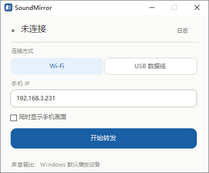

<p align="center">
  
</p>

<h1 align="center">SoundMirror</h1>

<p align="center">
  无线投屏工具：可选<b>只投音频</b>，或<b>音频与画面一起投</b>到电脑 —— 走 Wi-Fi 或 USB，<b>完全不占用蓝牙</b>。
</p>

<p align="center">
  <a href="LICENSE"></a>
  
  
</p>

---

A wireless casting tool for Windows: stream your phone's **audio only**, or **audio together with the screen**, to your PC over Wi-Fi or USB — without touching Bluetooth. Chinese UI, single-file script, no installation.

## 为什么做这个

市面上的方案要么只能投屏、要么只能传声音，要么得占用蓝牙（然后你就没法同时用蓝牙耳机了）。SoundMirror 的做法是把两件事合成一个开关：

- **只要声音** → 勾掉画面，纯音频转发，延迟低、音质无损
- **声音 + 画面** → 勾上，手机屏幕和声音一起过来

底层用的就是 scrcpy 的音频转发能力，所以不需要在手机上安装任何 App，也不经过应用商店的安装校验（华为等开启纯净模式的机型尤其受用）。

## 特性

| | |
|---|---|
| **双通道** | 音频单独转发，或音频 + 屏幕镜像，一个勾选框切换 |
| **两种连接** | Wi-Fi（免线，`adb tcpip`）或 USB（最稳，延迟恒定） |
| **手机零安装** | 只往 `/data/local/tmp` 推一个 server，不装 App、不触发纯净模式 |
| **蓝牙保持空闲** | 音频走 USB / Wi-Fi，蓝牙耳机照常用于电脑 |
| **失败有话说** | 连不上时不用猜——界面直接给出下一步排查方向，日志窗口可看原始输出 |
| **图形界面** | 输入 IP → 点开始，不用记命令行参数 |
| **原生 exe** | 可编译成无控制台窗口的 exe，图标、版本信息齐全 |

## 界面

<p align="center">
  
</p>

- 圆点是状态：灰=空闲，橙=连接中，绿=转发中，红=失败
- 选「USB 数据线」时 IP 输入框自动禁用变灰，不需要填
- 转发中同一个按钮变成「停止转发」，关窗口会二次确认

## 环境要求

- Windows 10 / 11
- PowerShell 5.1（系统自带）
- 手机：Android 11+（对应 `ro.build.version.sdk` ≥ 30）。HarmonyOS 4.x 的兼容层是 API 31，可用
- 手机上开启「USB 调试」

## 快速开始

### 1. 获取 scrcpy 运行文件

仓库不含 scrcpy 二进制（约 26 MB）。执行一次自动下载：

```powershell
.\Setup-Scrcpy.ps1
```

脚本会下载官方 scrcpy v5.0.1，与官方 `SHA256SUMS.txt` 比对哈希后解压到 `scrcpy\scrcpy-win64-v5.0.1\`。国内网络默认走镜像加速。

### 2. 手机端准备

1. 设置 → 关于手机 → 连点「版本号」7 次，开启开发者选项
2. 系统和更新 → 开发人员选项 → 打开 **USB 调试**
3. 同一页面打开 **「仅充电」模式下允许 ADB 调试**
4. 华为 / HarmonyOS 额外注意：还有一个独立的 **「ADB 调试（安全设置）」** 开关，默认关闭。不打开的话，即使开了 USB 调试也连不上——这是最容易漏的一步

### 3. 建立连接

**USB 模式**：插上线，手机通知栏把 USB 模式切成「传输文件」，界面里选「USB 数据线」即可。

**Wi-Fi 模式**：第一次仍需插一次线，把 adb 切到 TCP：

```bat
cd scrcpy\scrcpy-win64-v5.0.1
adb devices
adb tcpip 5555
adb connect 192.168.1.50:5555    :: 换成手机 WLAN 里显示的 IP
```

看到 `connected to 192.168.1.50:5555` 就可以拔线了。之后界面里填这个 IP，选 Wi-Fi，点开始。

> 手机重启或电脑的 adb 服务重启后，5555 端口会失效，需要重新插线跑一次 `adb tcpip 5555`。

### 4. 启动

```bat
SoundMirror.bat
```

或双击编译好的 `SoundMirror.exe`。

## 编译成 exe（可选）

仓库不带 exe。编译脚本用系统自带的 .NET Framework 编译器，无需安装任何工具：

```bat
Build-EXE.bat
```

产物是 `SoundMirror.exe`（约 15 KB，原生 Windows 程序），图标和版本信息已经嵌好。

这个 exe 是一个**启动器**：它用 `CreateNoWindow` 起 PowerShell 去跑 `sound-mirror.ps1`，所以没有黑框闪烁，任务管理器里也能看到 `SoundMirror.exe` 这个进程。

`SoundMirror.bat` 保留作为备用入口——万一 PowerShell 执行策略或杀软拦了 exe，双击 bat 通常还能起来。

## 常见问题

**连不上，界面提示「连接失败」**

按顺序查：手机 IP 是否变了（Wi-Fi 里看）、电脑和手机是否同一网段、路由器是否开了 AP 隔离、手机是否重启过导致 `adb tcpip` 失效。

**能连上但没声音**

声音走的是 **Windows 默认播放设备**。先确认它是你想出声的那个（蓝牙耳机 / 音箱），再检查手机音量。如果手机音量是 0，转过去也是静音。

**某些 App 的音频转不出来**

带 DRM 保护的应用（部分视频、音乐客户端）会禁止系统采集音频，转出来是静音。这是系统级限制，没有绕过办法。

**想同时用蓝牙耳机**

完全没问题。这个工具不碰蓝牙——音频走 USB 或 Wi-Fi，蓝牙完整留给耳机。

**Wi-Fi 下延迟越来越大**

scrcpy 有音频缓冲管理，一般比老的 sndcpy 稳很多。若长时间播放后出现累积延迟，点「停止转发」再「开始转发」重启一次链路。

## 项目结构

```
SoundMirror/
├── sound-mirror.ps1              # 主程序：WinForms 界面 + scrcpy 调用（约 600 行）
├── src/
│   └── SoundMirrorLauncher.cs    # exe 启动器源码（C#）
├── SoundMirror.bat               # 备用启动入口
├── Build-EXE.bat                 # 一键编译 exe
├── Setup-Scrcpy.ps1              # 下载并校验 scrcpy
├── app.ico                       # 应用图标（7 个尺寸）
├── build_ico.py                  # 从 PNG 生成多尺寸 ICO
├── screenshot.png                # 界面截图
└── icon-preview-256.png
```

界面用 Windows 自带的 WinForms 实现，所有圆角、状态徽标、分段控件都是 `GraphicsPath` + `SmoothingMode.AntiAlias` 自绘——WinForms 原生控件只有直角，而 `Region` 裁切是硬边遮罩，边缘锯齿无法接受。

## 致谢

- [scrcpy](https://github.com/Genymobile/scrcpy) — 音频转发与屏幕镜像的核心能力，作者 rom1v，Apache-2.0
- [Android platform-tools](https://developer.android.com/studio/releases/platform-tools) — adb

本项目只包含图形界面和流程编排，真正干活的是 scrcpy。

## 许可证

[MIT](LICENSE)
